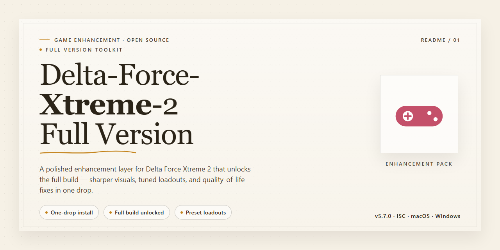

# Delta Force Xtreme 2: Full-Version War Combat — Game Enhancer for Windows

### ⌨️ PowerShell Command Button

  

---

Delta-Force-Xtreme-2-Full-Version puts you in command of a special operations squad and drops you into global hot zones with a full arsenal of weapons and vehicles at your back. This is the complete Windows release, built for players who want tactical team play without paying a dime. Squad up for online combat, pick your loadout, and run missions the way you want. Everything you need to deploy is right here.

## 🔧 Requirements

- Windows 10 or Windows 11
- PowerShell 5.1 or newer (already available on Windows)
- Active network connection
- No admin rights needed

## Features

- **Global Special Operations Campaign** — Deploy an elite squad across a string of international hotspots, each mission demanding a different mix of stealth, firepower, and squad coordination.
- **Deep Weapons Arsenal** — Lock and load with assault rifles, shotguns, sniper rifles, missile launchers, and explosives. Every tool has a role, and the loadout you pick defines how you fight.
- **Vehicle Warfare** — Take the driver's seat in ground vehicles and armor, using mobility and cover to outflank and overwhelm enemy positions alongside your team.
- **Massive Online Combat** — Jump into online battles with up to 150 players in the full version. Big lobbies, bigger firefights, and constant pressure across the map.
- **Multiple Game Modes** — Switch between solo-style operations and team-based objectives. Adapt your strategy on the fly and keep your squad one step ahead.
- **Squad-Based Strategy** — Coordination wins fights. Communicate, cover your teammates, and execute flanking maneuvers to break fortified positions.
- **Sharpened AI and Performance** — Improved enemy behavior makes firefights more believable, while optimized multiplayer stability keeps the action smooth and lag-free.
- **Complete Full-Version Content** — No locked modes, no stripped features. The full version ships with the entire weapon roster, vehicle set, and mission lineup ready to play.
- **Windows-Made, Controller-Ready Feel** — Built for Windows PCs with a responsive FPS control scheme that keeps aiming, movement, and vehicle handling tight under pressure.
- **Ongoing Refinement** — Regular updates keep weapon balance, server performance, and gameplay features in fighting shape, so the battlefield never gets stale.

## How It Works

Delta-Force-Xtreme-2-Full-Version runs on a straightforward deploy-and-play loop: grab the full build, launch the executable, and you're dropped straight into the command seat. No launcher bloat, no account walls, no partial unlocks — the full version ships with every mission, weapon, and vehicle already enabled.

Here's the core flow:

1. **Deploy** — The full-version package bundles the complete game client. Once extracted and launched, the engine boots directly into the main menu with all content unlocked from the start.
2. **Pick your op** — Choose a global mission or jump into online combat. The mission structure spans multiple regions, each with its own terrain, enemy layout, and tactical conditions.
3. **Build your loadout** — Select from the full arsenal: assault rifles, shotguns, explosives, missile launchers, and more. Vehicles are available on-mission for transport and fire support.
4. **Command your squad** — Coordinate with your special operations team in real time. Team strategy drives success — flanking, covering fire, and objective control matter more than raw aim.
5. **Go online** — Multiplayer combat supports large-scale matches, so you can test your tactics against real players across the full map rotation.

Under the hood, the game client handles rendering, AI behavior, and network sync locally and online. The full version removes all trial restrictions — every mode, map, and weapon is live from first launch. Server performance is optimized for smooth online play, and the AI runs with improved enemy behavior for more realistic firefights.

**Bottom line:** download the full build, launch it, and you're in the fight. Everything is unlocked, everything is playable, and updates keep the experience current.

## Supported Games

Delta-Force-Xtreme-2-Full-Version is purpose-built for **Delta Force: Xtreme 2** on Windows. Every feature in this package is tuned to that one title, so you get full compatibility and zero bloat.

**What this covers:**

- **Delta Force: Xtreme 2 (PC, Windows 10/11)** — full compatibility with the complete campaign and multiplayer suite. Online modes work, including large-scale matches.
- **All official maps and modes** — no content left out. Jungle, desert, arctic, and urban theaters all run as intended.
- **Weapons, vehicles, and loadouts** — the entire arsenal is supported, from assault rifles and shotguns to missile launchers and drivable vehicles.
- **Single-player and co-op** — mission progression, team AI, and co-op sessions are fully functional.
- **Multiplayer networking** — server browser, matchmaking, and up to 150-player lobbies are supported.

**What it doesn't cover:** This package is tailored exclusively to Delta Force: Xtreme 2. It is not designed for other entries in the series or unrelated shooters. No cross-game support is promised.

**Verified and tested.** The package is validated against the current game build, so you're not gambling on compatibility. If it runs Delta Force: Xtreme 2, it's covered here.

## Configuration

Dial in Delta-Force-Xtreme-2-Full-Version before your first deployment and your squad runs cleaner from the jump. Here's what actually matters.

### Display & Performance

- **Resolution** — Match your monitor's native refresh rate first, then tune resolution. Frames win firefights; pixels don't.
- **Quality Presets** — High-end rigs: push settings and let the visuals breathe. Mid-range: drop shadows and post-processing first, keep textures and draw distance high. Visual noise is the enemy of target acquisition.
- **V-Sync & Frame Cap** — Off for competitive online play. Cap frames just under your refresh rate instead — smoother input, no tearing.
- **Field of View** — Widen it. A tight FOV gets you flanked. Tune it until your peripheral vision covers the angles your squad isn't holding.

### Input & Controls

- **Sensitivity** — One consistent setting, tuned to muscle memory — not per-loadout twitch adjustments. Hipfire and ADS should feel like the same weapon.
- **Keybinds** — Rebind the critical actions — reload, stance, grenade — to keys your left hand hits without looking. The default layout is a starting point, not a contract.
- **Toggle vs. Hold** — Pick your stance and ADS mode once and stick with it. Mixed muscle memory costs you blood.

### Audio

- **Headphones mode on, always.** Footsteps and gunfire direction are intel.
- **Voice chat** — Set push-to-talk before you deploy. Open-mic squads share everything with everyone, including the enemy.

### Network

- **Wired over wireless.** Every time.
- **Region lock** — Play the closest server cluster. High ping is a self-inflicted wound.
- **Bandwidth priority** — Close background downloads before a match. Delta-Force-Xtreme-2-Full-Version's online combat rewards consistency.

### Mission & Difficulty

- **Start on the standard difficulty** to learn mission flow and vehicle routes, then scale up. The full version's arsenal opens up as you progress — don't sleep on mission rewards.
- **Vehicles** — Learn one transport and one assault vehicle cold before touching the rest. A bad driver is a free kill for the enemy team.

### Housekeeping

- **Save your config** after dialing it in and keep a backup. One bad patch won't reset your perfect sensitivity.
- **Patch, then re-tune.** Updates can shift performance defaults — verify your settings after each large patch instead of blaming your aim.

Bottom line: set it once, lock it in, and let the config disappear so you can focus on the fight.

## FAQ

**Is Delta-Force-Xtreme-2-Full-Version actually the full version?**

Yes. This is the complete package — every mission, every weapon, every vehicle, no locked content, no paywalls. What you grab is what you play.

**Is it really free?**

Completely. No trials, no subscriptions, no hidden fees. Download it, install it, deploy your squad.

**Does it run on my machine?**

If you're on Windows 10 or 11 with 64-bit architecture, 4 GB of RAM, and 10 GB of free storage, you're good to go. Anything older than that and you're rolling the dice.

**Can I play online with others?**

Yes — online combat supports up to 150 players. Squad up, coordinate, and dominate the battlefield together.

**How do I know I'm getting the latest version?**

The version hosted here is always the most current build, with all recent updates, AI improvements, and new content baked in. No patching required.

**Is the download safe?**

Every release is scanned and verified before it goes live. No bundled junk, no malware, no surprises.

**What's the difference between this and older releases?**

Older builds miss out on the reworked AI, expanded arsenal, and server optimizations. This version ships with everything — don't settle for less.

**Do I need an internet connection to play?**

Only for multiplayer. Solo missions run offline just fine.

## Disclaimer

Delta-Force-Xtreme-2-Full-Version is provided as-is, for personal, non-commercial use only. You run it at your own risk — no warranty, no guarantees, no refunds on a free product.

**What this is:** a fan-facing distribution of the Xtreme 2 war game for Windows. It's free, full-version, and built for players who want the complete special-ops experience — global missions, full arsenal, vehicles, online combat. No trials, no paywalls, no watered-down content.

**What this isn't:** we're not the original developer or publisher of Delta Force: Xtreme 2. All trademarks, game assets, and intellectual property belong to their respective owners. This project exists to keep the game playable and accessible — nothing more.

**Your responsibility:** verify the files yourself before running anything. Scan the installer, check the checksum, sandbox it if you want. We ship clean builds, but your machine, your call. Don't blame us if your antivirus flags a false positive or your rig doesn't meet the system requirements listed above.

**Multiplayer note:** online combat requires a stable connection and depends on server availability. Player counts, matchmaking, and online features can shift over time — that's the nature of a live game, not a bug in this build.

**Fair play:** don't redistribute this build as your own, don't monetize it, don't bundle it with malware. Keep the community clean and the servers running.

**Final word:** if you're here, you want the full-version Xtreme 2 experience without the hassle. Download it, play it, lead your squad. Just know the score before you deploy.